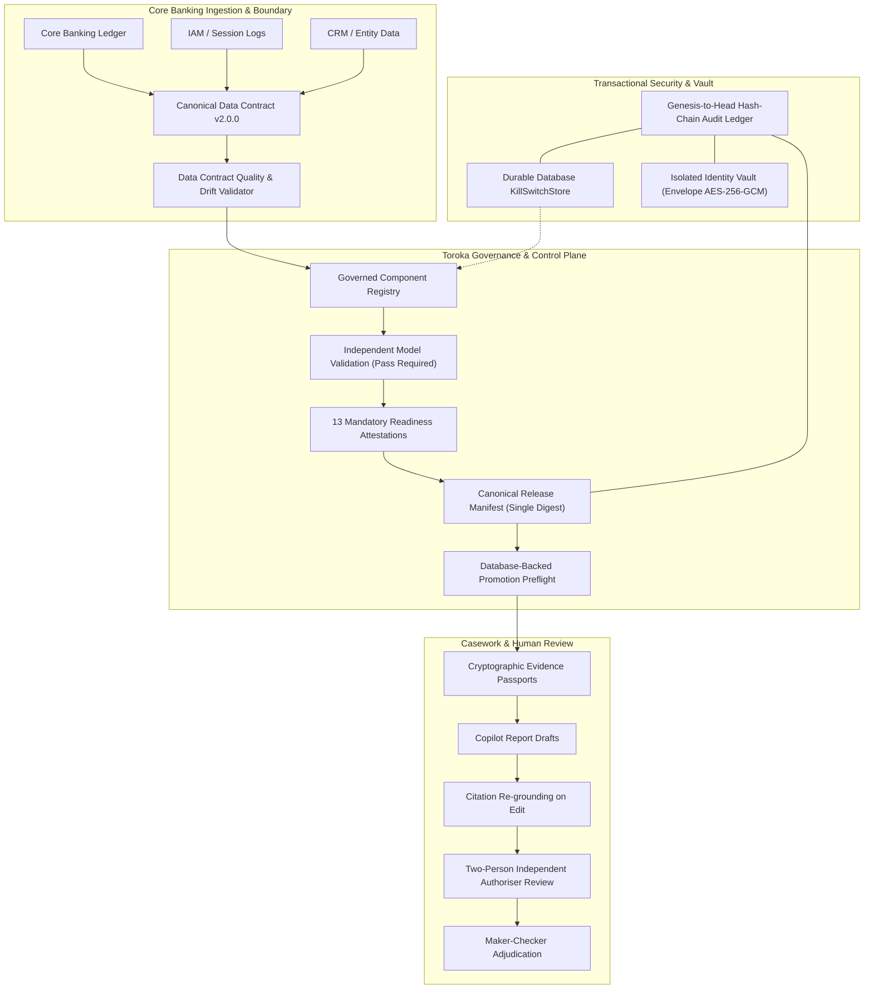

# Toroka Enterprise — Phase 12.6 Bank Pilot Pack
**Document ID:** `TOROKA-PILOT-PACK-12.6`  
**Classification:** Confidential — Financial Institution Pilot & Supervisory Inspection  
**Base Commit / Target Revision:** Phase 12.6 (`feat/phase-12-6-bank-pilot-integrity`)  
**Evaluation Standard:** NIST AI RMF 1.0, OCC Bulletin 2011-12 / SR 11-7 (Model Risk Management), CBK Prudential Guidelines  

---

## Executive Summary & Non-Complacency Notice

This Pilot Pack documents the architectural integrity controls, cryptographic verification mechanisms, and test evidence for **Toroka Enterprise Phase 12.6**. 

> [!CAUTION]
> **Strict Operational Notice:**  
> The successful execution of automated unit, API, integration, and security test suites does **not** constitute formal banking certification, statutory regulatory approval, or a warranty of error-free production safety.  
> 
> Operation within live commercial banking environments requires formal institutional governance approvals, verification against bank-specific physical HSM infrastructure, isolated database hosting (PostgreSQL), and explicit sign-offs from internal Risk, Audit, and Compliance committees.

---

## 1. System Architecture & Governance Topology

### 1.1 Architectural Principles
Toroka Enterprise provides an evidence-first, audit-anchored fraud detection and insider-risk intelligence platform for commercial banking institutions.
- **Fail-Closed Governance:** Any missing telemetry, unresolved data contract violation, or unverified gate evaluation automatically resolves to `UNKNOWN`, blocking production promotion and marking engine health as unverified.
- **Cryptographic Grounding:** Finding claims, evidence records, component configurations, and deployment manifests are bound via SHA-256 digests and HMAC-verified chains.
- **Independent Dual-Control (Maker-Checker):** Strict role separation enforced across release deployment, component approval, model evaluation, identity resolution, and report sign-off.



### 1.2 Separation of Duties Matrix

| Workflow Phase | Action | Allowed Role(s) | Prohibited Role / Conflict | Enforced Constraint |
| :--- | :--- | :--- | :--- | :--- |
| **Component Registration** | Register detector / model | `authoriser`, `admin` | Cannot evaluate or approve own component | Registered maker recorded in DB |
| **Model Validation** | Execute validation suite | `validator`, `qa_team` | Must differ from component author and approver | Evaluator subject validated against maker & approver |
| **Component Approval** | Approve for production | `authoriser`, `admin` | Cannot be component maker or evaluator | Maker-checker dual control; validation digest verified |
| **Release Assembly** | Create release manifest | `authoriser`, `admin` | Cannot promote own release | Immutable content digest computed |
| **Production Promotion** | Promote release to PROD | `authoriser`, `admin` | Release maker blocked from self-promotion | All 13 readiness gates verified in DB with active pass attestations |
| **Component Kill Switch** | Suspend / resume component | `authoriser`, `admin` | Requires substantive reason; tenant-scoped | Transactional lock; audit appended; immediate quarantine |
| **Copilot Report Edit** | Edit drafted report | `investigator`, `authoriser` | Edits re-validate citations against evidence context | Version incremented; digest recalculated; edit audited |
| **Copilot Report Sign-off** | Accept / reject report | `authoriser`, `admin` | Creator/editor strictly barred from reviewing own report | Independent reviewer required; rationale mandatory |
| **Identity Link Collapse** | Confirm entity identity | `authoriser`, `admin` | Proposer, Reviewer 1, and Reviewer 2 must be 3 distinct principals | Dual-control human confirmation; infrastructure attributes blocked from collapsing persons |

---

## 2. Phase 12.6 Security & Governance Control Matrix

| Control ID | Domain | Phase 12.6 Implementation | Verification Method | Enforcement Level |
| :--- | :--- | :--- | :--- | :--- |
| **CTRL-12.6-01** | Release Governance | Single canonical release manifest payload (`release_manifest_payload`) and digest calculation (`compute_release_manifest_digest`) using sorted JSON and microsecond UTC. | `test_canonical_release_manifest_integrity_and_tamper_detection` | Strict HMAC digest check; database preflight |
| **CTRL-12.6-02** | Promotion Preflight | Database verification of all components, passing independent validation runs, and persisted component approval records. | `test_release_promotion_tamper_detection` | 422 Unprocessable on missing component, unapproved state, or tampered digest |
| **CTRL-12.6-03** | Gate Attestations | Attestations persisted in `ReadinessAttestationRecord` table for all 13 `MANDATORY_GATES`. Status stored in DB, not caller request. | `test_canonical_release_manifest_integrity_and_tamper_detection` | Promotion blocked if any of the 13 gates lack an active pass attestation |
| **CTRL-12.6-04** | Evidence Passport | Cryptographic binding of exact `IntelligenceEventRecord` rows to `TorokaEvidencePassport`. Full payload stored in DB; re-verified on fetch. | `test_evidence_passport_persisted_events_and_tamper_detection` | Event count, observation times, and source systems validated; payload tampering invalidates passport |
| **CTRL-12.6-05** | Durable Kill Switch | Transactional `DatabaseKillSwitchStore` with `record_suspension` and `record_resume` updating component state and audit chain in 1 transaction. | `test_kill_switch_cross_session_persistence` | Fail-closed; no in-memory fallback in production; session-isolated verification |
| **CTRL-12.6-06** | Copilot Governance | Report edits require re-grounding citations (`[Cites: ev_id]`) against stored evidence snapshot. Review requires independent authoriser. | `test_copilot_report_grounding_edit_and_maker_checker` | Self-review blocked (403); grounding mismatch blocked (422); edit audited |
| **CTRL-12.6-07** | Control Plane Health | Control Plane health derives truth from database queries. Missing telemetry reports `UNKNOWN`. Fails closed on warning/critical. | `test_control_plane_health_and_audit_hash_chain_tamper` | Overall status equals worst observed pillar; broken audit chain triggers `CRITICAL` |
| **CTRL-12.6-08** | Two-Person Entity Link | 3-stage entity resolution: proposed -> `PENDING_SECOND_REVIEW` (first review) -> `SAME_ENTITY_CONFIRMED` (second review). | `test_two_person_entity_resolution_workflow` | Proposer, reviewer 1, and reviewer 2 must be different subjects; IP/device attributes cannot collapse identities |

---

## 3. Canonical Data Contract & Ingestion Boundaries

### 3.1 Data Contract Specifications
- **Contract Version:** `v2.0.0`
- **Supported Feed Formats:** Canonical Tabular CSV / JSON Run Manifest
- **Mandatory Feeds:**
  1. `core_banking_transactions` (Account, counterparty, amount, currency, timestamp, reference)
  2. `identity_access_management` (Subject, action, timestamp, source IP, device fingerprint, session ID)
  3. `customer_relationship_management` (Customer reference, risk category, onboarding date, status)
- **Data Quality & Schema Invariants:**
  - Strict type checking, ISO 8601 UTC timestamp parsing, and float-rounding prevention on monetary values.
  - Missing mandatory feeds immediately degrade detector health to `BLIND`.
  - Missing non-material optional fields log warnings without manufacturing false alerts.

---

## 4. Test Evidence & Automated Verification

### 4.1 Test Execution Metrics
- **Total Repository Automated Tests:** 1,288 tests
- **Overall Suite Pass Rate:** 100% (1,288 passed, 0 failed, 0 errors)
- **Test Categories Breakdown:**
  1. **Enterprise API & Phase 12.6 Integrity Controls:** 140 tests (`services/enterprise_api/tests`)
  2. **Enterprise Domain, Governance & Reconstruction:** 191 tests (`packages/enterprise/tests`)
  3. **Core Cryptography, Clustering & Shims:** 16 tests (`packages/core/tests`)
  4. **Detection Rules, Autonomous ML & Vocabulary:** 241 tests (`packages/rules/tests`)
  5. **Data Connectors, Sanitizers & SSRF Defense:** 50 tests (`packages/connectors/tests`)
  6. **Isolated Identity Vault (Envelope Encryption & AAD):** 5 tests (`services/identity_vault/tests`)
  7. **Consumer Verification, Scam Protection & Channels:** 645 tests (`services/api/tests`)

### 4.2 Security & Adversarial Test Coverage
- **Digest Tampering:** Intentionally corrupted manifest and passport digests tested; verified detection and rejection with HTTP 422.
- **Maker-Checker Violation:** Self-promotion of releases, self-approval of components, and self-review of Copilot reports tested; verified rejection with HTTP 403 / 422.
- **Audit Chain Tampering:** Intentional database row modification and hash manipulation tested; verified immediate detection by `verify_audit_chain`.
- **Tenant Isolation:** Cross-installation queries and cross-installation event binding rejected across all services.
- **Infrastructure Collapse Block:** Entity resolution engine tested against IP, subnet, and workstation links; verified that infrastructure links do not collapse identities even after two human reviews.

---

## 5. Known Limitations & Deployment Boundaries

1. **Single-Tenant Institutional Isolation:**
   - Architecture enforces single-tenancy per bank installation. Multi-bank shared database hosting on a single instance is neither designed nor supported.
2. **KMS & HSM Infrastructure Dependencies:**
   - Production operations require an institutional KMS (AWS KMS, Azure Key Vault, Google Cloud KMS, or PKCS#11 compliant hardware security module).
   - In local developer mode, ephemeral development keys are used; these are strictly rejected when `TOROKA_ENT_ENV=production`.
3. **Database Engine Requirements:**
   - Production environments strictly require **PostgreSQL 14+**. SQLite persistence is permitted only for isolated unit tests and local CLI evaluation; the application fails closed on startup if SQLite is configured in production.
4. **Third-Party AI Model Self-Assessment:**
   - Large Language Models are treated as ungrounded drafters. Toroka does not allow model self-certification or autonomous report submission; structural citation checks and human authoriser approval are strictly mandatory.

---

## 6. Deployment & Rollback Runbook

### 6.1 Database Migration Protocol (Alembic)
- **Target Revision:** `012_phase12_6_integrity_controls`
- **Revises:** `011_production_governance`
- **Tables Introduced:** `enterprise_readiness_attestations`
- **Columns Added:**
  - `enterprise_governed_components`: `approval_record_id`, `approved_validation_run_id`, `approved_validation_digest`, `approval_rationale`.
  - `enterprise_copilot_report_drafts`: `created_by`, `edited_by`, `edit_version`, `content_digest`, `grounding_status`, `grounding_report`, `evidence_context_snapshot`.
  - `enterprise_entity_link_candidates`: `proposed_by`, `first_reviewed_by`, `first_reviewed_at`, `first_review_rationale`, `second_reviewed_by`, `second_reviewed_at`, `second_review_rationale`, `evidence_digest`.
- **Execution Command:**
  ```bash
  alembic upgrade head
  ```
- **Rollback Command:**
  ```bash
  alembic downgrade 011_production_governance
  ```

### 6.2 Application Deployment
1. Set environment: `TOROKA_ENT_ENV=production`, `TOROKA_ENT_AUTH_MODE=oidc`.
2. Configure bank OIDC discovery URL and JWKS endpoints.
3. Verify isolated Identity Vault connectivity at `TOROKA_ENT_VAULT_SERVICE_URL`.
4. Run container as non-root user (`UID 10001`).
5. Verify health endpoint `/api/enterprise/v1/governance/health`.

---

## 7. Incident Response & Persistent Kill Switch Protocol

### 7.1 Kill Switch Execution
In the event of anomalous detector behavior, severe drift, or suspected model compromise:
1. Authorized bank authoriser invokes `POST /api/enterprise/v1/governance/kill-switch/suspend`.
2. Component status is updated to `SUSPENDED` in `enterprise_governed_components`.
3. Audit record is appended to the tamper-evident hash chain.
4. Active suspension record is written to `enterprise_suspension_audits`.
5. Transactions are committed synchronously. Component immediately ceases active execution.

### 7.2 Resurrection & Reinstatement Protocol
1. Model team investigates root cause and produces a remediation report.
2. An independent validation run is conducted on the fixed component version (`ValidationResult.PASS`).
3. Independent authoriser invokes `POST /api/enterprise/v1/governance/kill-switch/resume` with substantive justification.
4. Active suspension is cleared and logged to the audit trail.

---

## 8. Disaster Recovery & WORM Audit Trail Evidence

- **Hash-Chain Verification:** Every audit event links to its predecessor via `previous_event_hash`, forming an unbroken chain from genesis.
- **Head Anchoring:** The active head hash is regularly checkpointed and exported to immutable WORM storage.
- **Tamper Detection:** Any retroactive modification, deletion, or row insertion causes hash-chain traversal failure during `verify_audit_chain`.

---

## 9. Third-Party AI Risk & Model Governance

- **AI Provider Governance:** All AI providers (e.g. LLM providers for Copilot report drafting) must be registered in `enterprise_governed_ai_providers` with data retention terms, residency disclosures, and security approval.
- **No Direct Execution:** AI outputs are strictly constrained to drafting assistance; autonomous account actions, credit decisions, or police reports are prohibited.
- **Grounding Traceability:** Every factual claim must include an unambiguous `[Cites: ev_id]` token mapping directly to an inspected transaction or IAM event in the evidence context.

---

## 10. Institutional Acceptance Sign-off Matrix

| Workstream | Reviewing Authority | Department | Sign-off Status | Conditions / Notes |
| :--- | :--- | :--- | :--- | :--- |
| **Model Risk Management** | Head of Model Validation | Risk Management | `PENDING INSTITUTIONAL REVIEW` | Subject to bank validation dataset verification |
| **Information Security** | Chief Information Security Officer | Information Security | `PENDING INSTITUTIONAL REVIEW` | Subject to perimeter mTLS & HSM adapter testing |
| **Forensic Investigations** | Head of Financial Crime Operations | Forensic Operations | `PENDING INSTITUTIONAL REVIEW` | Casework workflow review in Workbench |
| **Internal Audit** | Chief Internal Auditor | Internal Audit | `PENDING INSTITUTIONAL REVIEW` | WORM storage checkpoint verification |
| **Data Governance** | Chief Data Officer | Enterprise Data Office | `PENDING INSTITUTIONAL REVIEW` | Data Contract v2.0.0 feed reconciliation |
